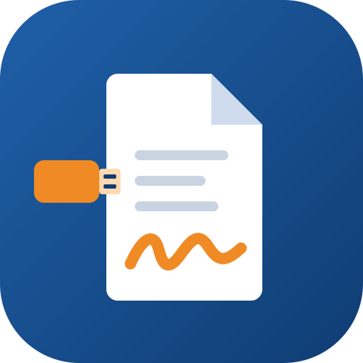

# DSC Bridge

Sign Frappe / ERPNext documents with the **USB DSC token** plugged into your own computer: one click on the
form or the print page, and a digitally signed PDF (PAdES, verified by Adobe Reader) is attached to the document.

A DSC (Digital Signature Certificate on a Class 3 USB token) cannot be read by a cloud server, so DSC Bridge keeps
the token where it is. A small **Connector** on the user's computer reads the token through the token's own driver
and signs the PDF there. The ERP only makes the PDF and stores the signed result.

## Pricing

- **App: free.** Install it from the Frappe Cloud Marketplace (or with bench) at no charge; the code is open source (MIT).
- **One-time setup & support package: USD 250** (pay in INR by UPI `frappe.erp@oksbi`): DSC Bridge set up on your
  site, the connector installed on your signers' computers (Windows / Mac, any USB token), the signature box placed on
  your own invoice print format, the first invoice signed with your real token together with you, a walkthrough for
  your billing team, and 12 months of e-mail support. Write to the support e-mail with your site address for the
  invoice (details in [SUPPORT.md](SUPPORT.md)).

## What it does

- **Sign with DSC** button on any document type you choose (Sales Invoice is pre-configured with ERPNext), on the
  form and on the print page (the print format and letterhead chosen there are used).
- Visible **signature stamp** in the Adobe style (name, DN, reason, location, date), placed automatically in the
  "Authorised Signatory" box of every copy of the invoice, or in a fixed box you set. A later e-Way bill page is
  left clean.
- **Any USB token**: ePass2003, ProxKey / WatchData, mToken, SafeNet, HYP2003 (HyperPKI), TrustKey, Gemalto,
  or any other with a PKCS#11 driver. The connector picks the driver that sees the plugged-in token and reads the
  certificate off it every time, so a new, renewed or other-company DSC needs no change anywhere.
- **Private by design**: the PIN is typed in the ERP dialog but goes only to the connector on the same computer,
  is used once and never stored; the private key never leaves the token; the ERP server never sees either.
- **DSC Sign Log**: who signed which document, when, with which certificate, and the file.
- Connector kits for **Windows** (one-click, no Python install needed) and **Mac**.
- Open source, MIT licence. Works on plain Frappe; ERPNext is optional.

## How a signing goes

1. The user opens a submitted Sales Invoice and clicks **Sign with DSC** (form, or the print page).
2. The dialog shows the certificate found on the token ("Signing as ..."), the print format, the DSC PIN, Reason and
   Location.
3. The browser fetches the document's PDF from the site, sends it to the connector at `http://127.0.0.1:47831`, the
   connector signs it with the token, and the browser attaches the signed PDF to the document as
   `<document name>-DSC.pdf`. A DSC Sign Log entry is written.

The signed PDF is a normal private attachment: print it, mail it from the document's Email dialog, or let your own
scripts pick it up.

## Setting up

### 1. In the ERP (once)

Open **DSC Bridge Settings**:

- **Document Types**: the document types that get the button, with an optional default print format, "submitted
  only" (default on) and a Reason such as *Tax Invoice*.
- **Signature defaults**: default Reason and Location; *Location From Field* takes the Location from a field of the
  document when it has one (default `place_of_supply`, so "07-Delhi" becomes "Delhi").
- **Connector URL** stays `http://127.0.0.1:47831` unless you changed the connector's port.

Users reload the browser page after a change. The button is shown to users who may print the document.

### 2. On each signer's computer (once)

Install the **DSC Bridge Connector** from the [Releases](../../releases/latest) page:

- **Windows 10/11**: download `DSC_Bridge_Connector_Windows_<version>.zip`, right-click → *Extract All*, open the
  folder, double-click `install.bat`. It installs into `%LOCALAPPDATA%\DSCBridge`, starts with Windows and opens
  its status page. Python and the signing libraries are inside the zip; nothing else to install. The token's own
  driver must be on the PC (it already is wherever that DSC is used for GST, Income Tax or MCA filings).
- **Mac**: download `DSC_Bridge_Connector_Mac_<version>.zip`, unzip, double-click `install.command` (needs
  Python 3 and the token's Mac driver). Restart the Mac after installing a Feitian / Hypersecu driver.

Open `http://127.0.0.1:47831/` in the browser: it shows the token and the certificate name and validity.
Details, configuration (`config.json`) and troubleshooting: [connector/README.md](connector/README.md).

### 3. Sign

In the ERP, open a submitted document → **Sign with DSC** → check the signer line → PIN → **Sign and Attach**.
The first time, Chrome asks to allow access to the local network: allow it.

## Requirements

- Frappe v15 (ERPNext optional).
- Browser: Chrome, Edge or Firefox. They let an HTTPS site talk to a connector on the same computer; Safari does not.
- A USB DSC token with its driver installed on the signer's computer, and the DSC Bridge Connector.

## Security and privacy

- The connector listens on `127.0.0.1` only: no other computer can reach it.
- Which sites may use the connector is set in its `config.json` (`allowed_origins`, default any site). Every
  signing still needs the PIN, typed by the user for that one signing.
- The ERP accepts a signed PDF only from a user who may print that document, only for document types enabled in
  the settings, and only when the file really carries a PDF signature. The file is attached as private.
- Nothing is sent to the publisher of this app or to any third party. No telemetry.
- Whether a signature is legally valid depends on the certificate (its CA, validity, who holds the token), not on
  this app. Readers see the stamp and can verify the signature with the signer's CA chain, which is embedded.

## Troubleshooting

| Message | What to do |
|---|---|
| The DSC Bridge Connector is not running on this computer | Start it (Windows: `start.vbs` in `%LOCALAPPDATA%\DSCBridge`, or restart the PC; Mac: `start.command`). |
| DSC token driver (PKCS#11 library) not found | Install the token's driver. A driver in an unusual place: put its path in `config.json` → `pkcs11_lib`. |
| DSC token not found / Token could not be read | Take the token out, plug it in again, try again. |
| Wrong PIN / The DSC PIN is locked | The token's PIN. A locked PIN is unlocked only with the token maker's utility. |
| The certificate on this DSC has expired | Renew the DSC; the connector reads the new certificate by itself. |
| No button on the document | Check DSC Bridge Settings (enabled, document type listed), the user's print permission, and reload the page. |

The connector writes `connector.log` next to itself (never the PIN).

## Support and paid setup

Questions and problems: [GitHub issues](../../issues) or the support e-mail on the marketplace page.
Want it set up for you (connector on your PCs, the signature box on your own print format, first signing with
your real token, team walkthrough)? A one-time remote setup is available, see [SUPPORT.md](SUPPORT.md).
Also [PRIVACY.md](PRIVACY.md) and [TERMS.md](TERMS.md).

## Licence

MIT. See [license.txt](license.txt).
